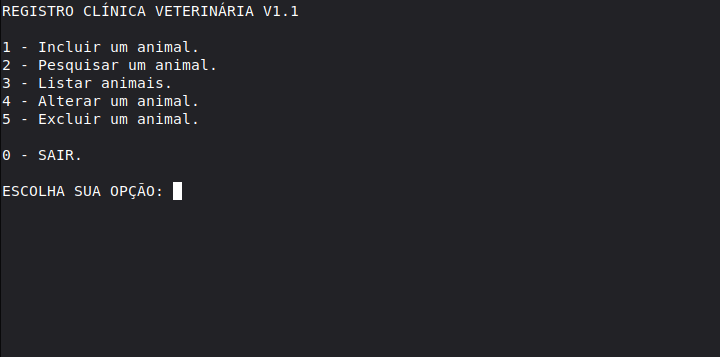

# clinicaveterinaria
Um programa para lidar com os cadastros de animais de uma clínica veterinária fictícia.

## Implementação
Implementado, inicialmente, para funcionar apenas na memória RAM (sem gravação estática), mas com toda a estrutura (vetor principal e quantidade de elementos) gravável com facilidade em arquivos binários.

O sistema possui as seguintes funcionalidades:
- Inclusão de animal
- Pesquisa de animal
- Listagem de animais
- Alteração de animal
- Exclusão de animal

### Estrutura:
***main.c***
- Vetor principal atualizado/realocado conforme as necessidades do programa. Além da contagem de animais.

***sistema.c***
- Funções necessárias ao funcionamento do registro. Todas as que modificam o tamanho do vetor retornam um novo ponteiro Animal e recebem a quantidade atual de animais por referência.

***cabecalho.h***
- Protótipos necessários das funções, declarações de tipos, constantes e algumas funções genéricas/multiplataforma.

## Como compilar
Para compilar é necessário ter o `gcc` instalado, abrir o terminal na mesma pasta do arquivo `comp.sh` e rodá-lo com o comando `bash comp.sh`.

## Como rodar
Abrindo o terminal na mesma pasta do binário compilado ou baixado, use o comando  `./trab2`.

#### FUNCIONAMENTO ESPERADO

## Possíveis melhorias
- Gravação dos animais em lista encadeada (diminui a realocação e cópia de partes significativas da memória).
- Sistema de gravação estático (salvamento em arquivos binários, de preferência encriptados). 